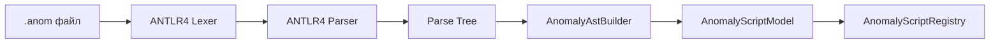

# ⚙️ Архитектура DSL-компилятора (DSL Script Engine)

Скриптовая подсистема мода `Anomalies` предназначена для компиляции файлов `.anom` в исполняемую модель конечного автомата.

---

## 🏗️ Конвейер компиляции (Pipeline)



---

## 🧩 Узлы дерева AST (`ICondition`)

Каждое логическое выражение в блоке `when` компилируется в дерево объектов, реализующих `ICondition`:

```java
public interface ICondition {
    boolean evaluate(EvaluationContext ctx);
}
```

### Основные узлы:
1. **Листовые узлы:**
   - `TimerCondition(int requiredTicks)`: Проверяет `ctx.getTicksInState() >= requiredTicks`.
   - `ChanceCondition(double probability)`: Проверяет `random.nextDouble() < probability`.
   - `PlayerInZoneCondition(int zoneIndex)`: Проверяет присутствие игрока в зоне через `TransientZoneCache`.
   - `PlayerZoneEventCondition(ZoneEventType type, int zoneIndex)`: Проверяет возникновение однократного события `ENTER` или `EXIT` в текущем тике.
2. **Композитные узлы:**
   - `AndCondition(ICondition left, ICondition right)`
   - `OrCondition(ICondition left, ICondition right)`
   - `NotCondition(ICondition inner)`

---

## 🧠 Кэширование событий (`TransientZoneCache`)

Для эффективной проверки событий входа/выхода без повторного геометрического сканирования используется статический сервис `TransientZoneCache`:

- **`tickEvents` (Одноразовые события):** Множество событий вида `(UUID игрока, ZoneEventType, zoneIndex)`. Очищается в конце каждого тика или при смене фазы аномалии (`flushTickEvents`).
- **`activeZoneStates` (Длительные состояния):** Множество состояний `IN_ZONE`. Сохраняется всё время, пока сущность остаётся внутри конкретной зоны.

---

## 📦 Загрузка датапаков (`AnomalyScriptLoader`)

Класс `AnomalyScriptLoader` расширяет `SimplePreparableReloadListener`:
1. Сканирует файлы с расширением `.anom` по маске `data/*/anomalies/*/*.anom`.
2. Валидирует структуру папок (имя файла должно строго совпадать с именем родительской папки).
3. Парсит синтаксическое дерево с помощью `AnomalyLexer` и `AnomalyParser`.
4. Через `AnomalyAstBuilder` конструирует `AnomalyScriptModel` и помещает её в `AnomalyScriptRegistry`.
