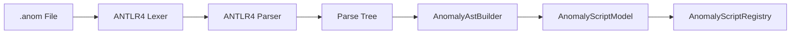

# ⚙️ DSL Script Engine Architecture

The DSL subsystem compiles `.anom` script files into executable state machine models.

---

## 🏗️ Compilation Pipeline



---

## 🧩 AST Condition Nodes (`ICondition`)

Transition conditions are compiled into an AST tree of `ICondition` objects:

```java
public interface ICondition {
    boolean evaluate(EvaluationContext ctx);
}
```

- **Leaf Nodes:**
  - `TimerCondition(ticks)`: Checks `ctx.getTicksInState() >= ticks`.
  - `ChanceCondition(probability)`: Evaluates random threshold.
  - `PlayerInZoneCondition(zoneIndex)`: Checks player presence via `TransientZoneCache`.
  - `PlayerZoneEventCondition(type, zoneIndex)`: Checks for single-tick `ENTER` or `EXIT` events.
- **Composite Nodes:** `AndCondition`, `OrCondition`, `NotCondition`.

---

## 🧠 Event Caching (`TransientZoneCache`)

`TransientZoneCache` manages transient events:
- **`tickEvents`:** Set of single-tick events `(playerUUID, eventType, zoneIndex)`. Flushed on state transitions.
- **`activeZoneStates`:** Set of continuous `IN_ZONE` states while the player remains inside.

---

## 📦 Datapack Loading (`AnomalyScriptLoader`)

`AnomalyScriptLoader` monitors `data/*/anomalies/*/*.anom` and loads valid scripts into `AnomalyScriptRegistry`.
